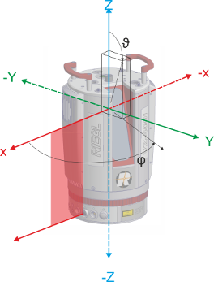
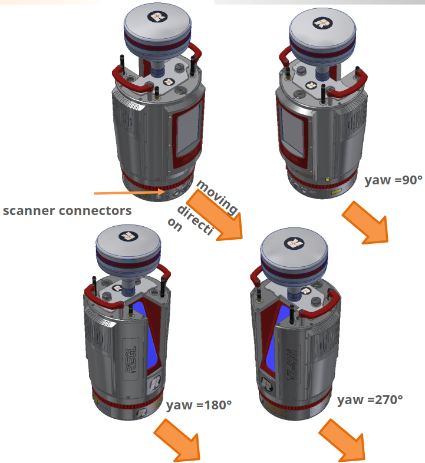

# ROS2 RIEGL VZ Package API (Kinematic Scanning)

This document describes the 'riegl_vz' ROS node extension for kinematic scanning.

## 1. Coordinate Systems

**SOCS** (Scanner's Own Coordinate System):  

The angle and range data are the base for calculating the data in the Scanner’s Own Coordinate System (SOCS).

**Navigation Frame**   

In order to use the kinematic mode, the navigation frame must be defined.  
For this, the   
Z-axis must be aligned in the direction of gravity
X-axis must be aligned in driving direction  
Y-axis must follow the right-hand rule

In order to rotate the SOCS into the Navigation Frame, the Euler angles must be set. The standard angles are

roll = 180 for the Z-axis to look downwards  
pitch = 0  
yaw = 180 so that the LAN plug points backwards and won't be damaged by dirt

## 2. 'riegl_vz' Node Extension

### 2.1 Parameters

**~kinematic_force_rtk_fix** (bool, default: true) :

Blocks data recording until rtk_fix is available.

**~kinematic_gnss_configuration** (string, default: "GNSS On Top") :

Selects the GNSS configuration to be used.

**~kinematic_gnss_post_processing** (bool, default: false) :

Forces the use of external base station data in post processing.

**~kinematic_project** (string, default: "MyProject001") :

The name of the project to be loaded or created.

#### 2.1.1 Navigation Frame

**~kinematic_navigation_frame_roll** (float, default: 180.0) :

Defines the roation about the X-axis from SOCS to Navigation Frame.

**~kinematic_navigation_frame_pitch** (float, default: 0.0) :

Defines the roation about the Y-axis from SOCS to Navigation Frame.

**~kinematic_navigation_frame_yaw** (float, default: 180.0) :

Defines the roation about the Z-axis from SOCS to Navigation Frame.

#### 2.1.2 Rotating Data Recording

**~kinematic_rotating_theta_start** (float, default: 30.0) :

Sets theta start angle.

**~kinematic_rotating_theta_stop** (float, default: 130.0) :

Sets theta stop angle.

**~kinematic_rotating_theta_increment** (float, default: 0.034) :

Sets theta step width.

**~kinematic_rotating_rotation_speed** (float, default: 150.0)

Rotation speed of the scanner over the Z-axis in °/s.

**~kinematic_rotating_measurement_program** (int, default: 3)

Sets the laser measurement frequency.  
4 = reflector 600 kHz  
3 = 2200 kHz  
2 = 1200 kHz  
1 = 600 kHz  
0 = 140 kHz

**~kinematic_rotating_change_direction** (integer, default: 3)

Changes the direction of rotation.

**~kinematic_rotating_change_direction_interval** (float, default: 30.0) :

Time between direction changes in s.

#### 2.1.3 Fix Angle Data Recording

**~kinematic_fix_angle_theta_start** (float, default: 30.0) :

Sets theta start angle.

**~kinematic_fix_angle_theta_stop** (float, default: 130.0) :

Sets theta stop angle.

**~kinematic_fix_angle_theta_increment** (float, default: 0.034) :

Sets theta step width.

**~kinematic_fix_angle_phi** (float, default: 90.0)

Sets the direction in which the scanner turns the laser.

**~kinematic_fix_angle_measurement_program** (int, default: 3)

Sets the laser measurement frequency  
4 = reflector 600 kHz  
3 = 2200 kHz  
2 = 1200 kHz  
1 = 600 kHz  
0 = 140 kHz

#### 2.1.4 Static Scan

**~kinematic_static_scan_pattern** (string, default: "")

Name of the scan pattern to be used while static scanning.

**~kinematic_static_scan_measurement_program** (int, default: 3)

Sets the laser measurement frequency  
4 = reflector 600 kHz  
3 = 2200 kHz  
2 = 1200 kHz  
1 = 600 kHz  
0 = 140 kHz

#### 2.1.5 Recording Mode

**~kinematic_recording_mode** (string, default: "kinematic") :

Mode can be "static" or "kinematic".

**~kinematic_mode_rotating** (bool, default: true) :

For kinematic mode the "rotating" attribute can be used to start either a rotating or non-rotating kinematic recording.

### 2.2 Services

**start_kinematic_mode** ([std_srvs/Trigger](https://github.com/ros2/common_interfaces/blob/master/std_srvs/srv/Trigger.srv)) :

Starts the kinematic mode and sets the kinematic project parameters.

Response:  
success = True -> message: ""

**stop_kinematic_mode** ([std_srvs/Trigger](https://github.com/ros2/common_interfaces/blob/master/std_srvs/srv/Trigger.srv)) :

Stops the kinematic mode.  
Kinematic recording needs to be stopped first.   

Response:  
success = True -> message: ""

**start_kinematic_recording** ([std_srvs/Trigger](https://github.com/ros2/common_interfaces/blob/master/std_srvs/srv/Trigger.srv)) :

Sets which recording mode to be used and starts it.  
Kinematic mode must be started first.

Response:  
success = True -> message: ""

**stop_kinematic_recording** ([std_srvs/Trigger](https://github.com/ros2/common_interfaces/blob/master/std_srvs/srv/Trigger.srv)) :

Stops kinematic recording.   

Response:  
success = True -> message: ""
